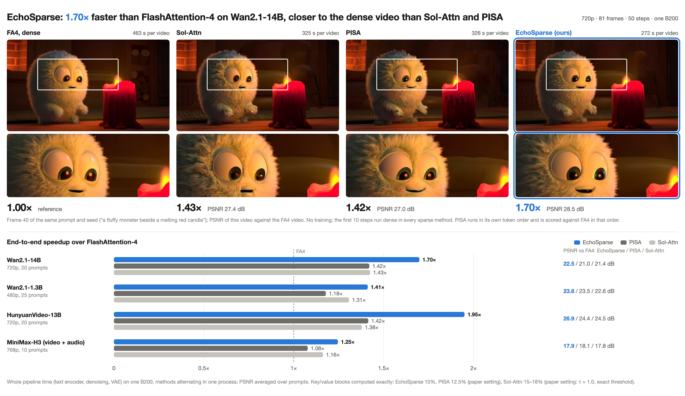
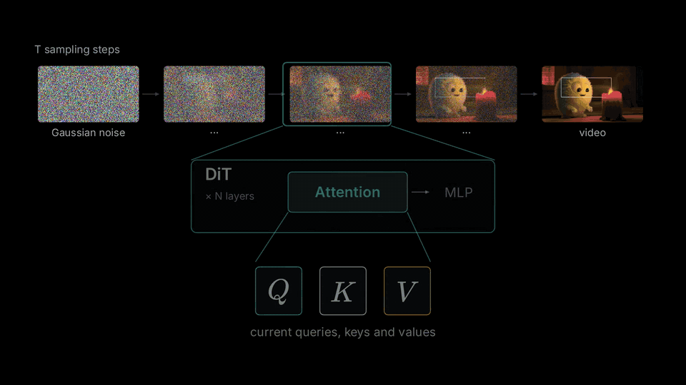
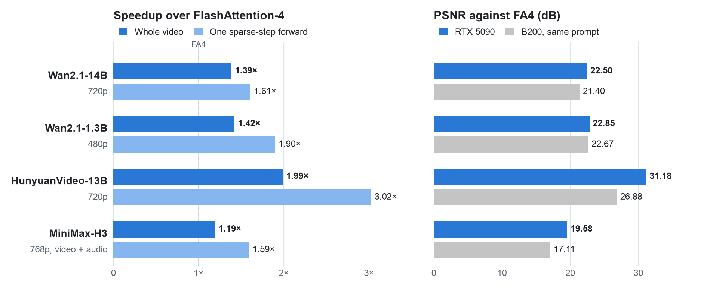
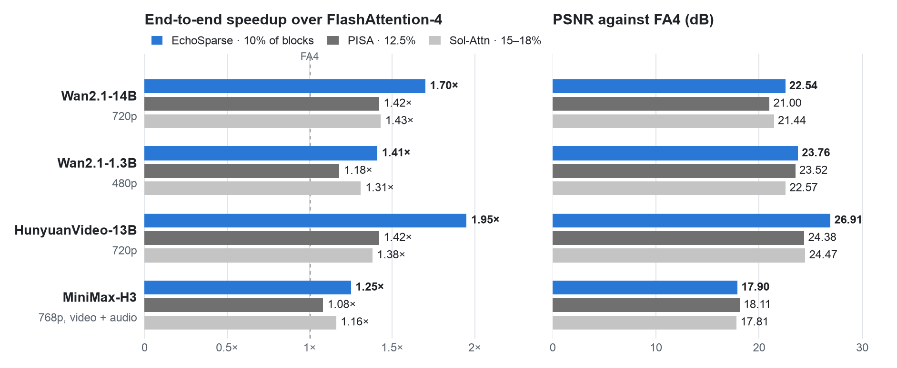

<div align="center">

<h1>Self-trainable or training-free attention</h1>

<p><b>EchoSparse, VSA and VSA2 · native CUDA attention</b></p>

<p>
<a href="https://w2genai-lab.github.io/blog/EchoSparse/blog.html"></a>
<a href="https://w2genai-lab.github.io/blog/EchoSparse/zh.html"></a>
</p>

<p><b><a href="https://w2genai-lab.github.io/blog/EchoSparse/blog.html">Blog</a></b> &nbsp;·&nbsp; <b><a href="https://w2genai-lab.github.io/blog/EchoSparse/zh.html">中文博客</a></b> &nbsp;·&nbsp; <a href="README_zh.md">中文说明</a> &nbsp;·&nbsp; <a href="#results">Results</a> &nbsp;·&nbsp; <a href="#installation">Installation</a> &nbsp;·&nbsp; <a href="#usage">Usage</a></p>



</div>

This repository contains the EchoSparse implementation and experimental **H100 VSA2 split-KV scheduling**.
The default schedule remains unsplit; automatic scheduling is opt-in. See the [usage and measured results](docs/vsa2_splitkv.md).

This branch also publishes the experimental VSA2 **64/4/1 representative-block** package. Its H100
ThunderKittens backend uses tensor TMA for tier A and the contiguous tier C table, plus 1-D
`cp.async.bulk` for the pre-swizzled tier B table. See the
[implementation and handoff](docs/vsa2_representative_handoff.md). This is distinct from the
EchoSparse Triton path described below.

- [Interactive animation — standalone HTML](docs/animations/vsa2-load-balance-standalone.html)
- [Canvas component](docs/animations/vsa2-load-balance.canvas.tsx) · [animation source and checks](docs/animations/README.md)

The animation illustrates an 8×D query, D×8 key transpose and 8×D value calculation with uneven selected-pair workloads.
Its timeline uses toy units; the H100 measurements are in the scheduling document above.

The package and import name remain `echosparse`. The upstream project is [W2GenAI-Lab/EchoSparse-Attn](https://github.com/W2GenAI-Lab/EchoSparse-Attn).

EchoSparse is block-sparse self-attention for video diffusion transformers. The softmax statistics of each
denoising step echo into the next one: they set its softmax offset, pick the blocks it computes and decide how
the skipped blocks are compensated. It needs no training and plugs into diffusers pipelines. It runs on NVIDIA
B200 (SM100), RTX 5090 (SM120) and H100 (SM90) GPUs.

## News

- **2026-11-05** — Native CUDA [VSA and VSA2](#native-vsa-and-vsa2) in `echosparse.vsa`: forward and backward on H100
  (SM90) and RTX 5090 (SM120).
- **2026-11-04** — EchoSparse runs on H100 (SM90): [results](#h100) · [usage](#on-an-h100).
- **2026-11-01** — The EchoSparse blog post is out: [English](https://w2genai-lab.github.io/blog/EchoSparse/blog.html) · [中文](https://w2genai-lab.github.io/blog/EchoSparse/zh.html).

## How it works

<p align="center">
  
  <br>
  <em>One attention layer on a toy example: the carried-over LSE, block selection, clustered representatives, the
single normalization and the fused B200 kernel, followed by the measured B200 results.</em>
</p>

Between two denoising steps, the log-sum-exp (LSE) of each attention row changes very little. EchoSparse keeps the
previous step's LSE of every layer and CFG branch and uses it in three places, all inside one attention kernel:

1. **Fixed softmax offset.** The previous LSE takes the place of the running row maximum, so the kernel does no
   max reduction and no rescaling. Tiles whose row sums leave a safe range (about 0.5% of them) are recomputed
   with online softmax. For the same block lists this cuts kernel time by about 47%.
2. **Block probabilities from the same pass.** With that offset the exp values are already close to
   probabilities, so the kernel sums them per 64-token block while it computes the selected blocks. The next step
   takes the top blocks of every 128-row query tile from this map; there is no separate scoring pass.
3. **Compensation of skipped blocks.** Skipped blocks still take part in the same softmax: each through its mean
   key and value, weighted by its token count, and the most probable third of them through four representatives
   each, found by k-means in the query metric.

The first 10 denoising steps run dense with FlashAttention-4. The last of them sends every block through the
kernel to build the first probability map.

On the B200 the kernels are written in CuTe DSL with tcgen05 MMAs and tensor memory. The RTX 5090 and the H100 have
neither, so their kernels are written in Triton with ordinary loads and tensor-core dots. They compute the same
quantities in the same precision. To fit in 32 GB, the RTX 5090 keeps per layer only the LSE of each CFG branch and
the next step's block selection, as bit masks; the probability map is scratch shared by all layers. The H100 keeps
the same state.

The Triton kernels take the compensation columns from two short lists per query tile, written when a step's block
selection is unpacked: the blocks left to their means and the refined blocks. These are the same columns with the
same weights as a masked pass over every block, without the masked-out work; only the order of summation changes.
The RTX 5090 kernel computes each 64-token block as two 32-key halves and 32 compensation columns at a time. The H100
kernel computes whole 64-token blocks with 8 warps, 128 compensation columns at a time, and in sparse steps
software-pipelines the exact-block loop over three stages so that the K / V gathers overlap the dots; it uses
ordinary pointer loads in that Triton implementation. The separate VSA2 representative-block kernel linked above
does use tensor TMA and asynchronous bulk copies on H100.

## Results

### RTX 5090

<picture>
  <source media="(prefers-color-scheme: dark)" srcset="assets/results-rtx5090-dark.png">
  
</picture>

Complete 50-step generations with this package and the scripts in `examples/`, one prompt per model with the seed of
the B200 evaluation; EchoSparse and dense FA4 each run once on one GPU. The weights of Wan2.1-14B, HunyuanVideo and
MiniMax-H3 stay in CPU memory and are copied to the GPU group by group (`--offload`); Wan2.1-1.3B sits on the GPU.
One forward is the median over a run's sparse steps (EchoSparse) and dense steps (FA4). MiniMax-H3 runs at density
0.24 (`minimax_h3_rtx5090`). Sol-Attn and PISA were not run on the RTX 5090.

### H100

Initial end-to-end results for Wan2.1-1.3B on one H100 80 GB: 50 steps, 81 frames at 480×832, seed 0, with all
weights resident on the GPU. Each method runs once with the same inputs; EchoSparse uses density 0.10 and keeps
the first 10 steps dense.

| Method | Complete generation / s | PSNR against FA4 / dB |
| --- | ---: | ---: |
| Dense FlashAttention-4 | 62.656 | — |
| Previous H100 EchoSparse (`sm90_wide`) | 49.492 | 24.835 |
| Grouped128 + exact three-stage pipeline | 47.487 | 24.831 |

The grouped path is 1.319× faster than FA4 and reduces generation time by 4.05% relative to the previous H100
path. Timing includes the complete pipeline and decode, excluding model loading, warmup, saving and scoring.
PSNR uses native float32 frames.

### B200

<picture>
  <source media="(prefers-color-scheme: dark)" srcset="assets/results-b200-dark.png">
  
</picture>

Complete video generation with 50 denoising steps; all methods keep the first 10 steps dense. EchoSparse computes 10%
of KV blocks; Sol-Attn uses its paper's exact threshold estimator with τ = 1.0 and computes 15–18%; PISA computes
12.5% with covariance-aware selection. PSNR is against FA4, averaged over 10–25 prompts per model.

EchoSparse has the highest speedup on all four models. Its PSNR gains over Sol-Attn are 1.10 dB on Wan2.1-14B,
1.19 dB on Wan2.1-1.3B, and 2.44 dB on HunyuanVideo. On MiniMax-H3, the differences are +0.09 dB relative to
Sol-Attn and −0.21 dB relative to PISA; audio SNR is 4.9 dB for EchoSparse and 5.4 dB for Sol-Attn.

With Sol-Engine's diagonal threshold estimator, Sol-Attn computes 21–25% of KV blocks. In model order as above,
its PSNR is 22.34, 23.39, 25.47, and 18.70 dB, with speedups over FA4 of 1.24×, 1.17×, 1.27×, and 1.10×.
EchoSparse matches its quality on Wan, gains 1.44 dB on HunyuanVideo, and gives 0.8 dB lower PSNR on H3,
while running 1.12–1.54× faster.

## TODO List

- [x] Adapt EchoSparse to NVIDIA H100 (SM90).
- [x] Report initial end-to-end H100 results for Wan2.1-1.3B.
- [x] Native CUDA VSA and VSA2, forward and backward, on H100 (SM90) and RTX 5090 (SM120).
- [x] Add the experimental H100 VSA2 64/4/1 representative-block ThunderKittens/TMA forward and backward path.
- [ ] Adapt EchoSparse to NVIDIA RTX 4090 (SM89).
- [ ] Develop a producer-consumer architecture using TMA to reduce memory stalls further.

## Installation

Requirements: a B200 (SM100), RTX 5090 (SM120) or H100 (SM90) GPU, CUDA 12.8 or newer, Python 3.10 or newer.

```bash
git clone git@github.com:shaoshitong/self_trainable_or_free_attn.git
cd self_trainable_or_free_attn
pip install torch==2.11.0 --index-url https://download.pytorch.org/whl/cu128
pip install -e ".[examples]"
```

Dependencies are pinned in `pyproject.toml`. On RTX 5090, EchoSparse applies the SM120 compatibility fix from
[flash-attention PR #2484](https://github.com/Dao-AILab/flash-attention/pull/2484) to FlashAttention-4.
MiniMax-H3 uses diffusers commit `abc5e9bf` and transformers 5.8.1.

For MiniMax-H3, keep its diffusers source alongside this repository:

```bash
git clone https://github.com/huggingface/diffusers.git ../diffusers-h3
git -C ../diffusers-h3 checkout abc5e9bf71fd38f53cd471bc3acaa84bc5ecbfdc
pip install transformers==5.8.1
export PYTHONPATH="$(pwd)/../diffusers-h3/src:${PYTHONPATH}"
```

## Usage

### Quick start

On a B200, with every weight on the GPU:

```python
import torch
from diffusers import AutoencoderKLWan, UniPCMultistepScheduler, WanPipeline
import echosparse

model = "Wan-AI/Wan2.1-T2V-14B-Diffusers"
vae = AutoencoderKLWan.from_pretrained(model, subfolder="vae", torch_dtype=torch.float32)
pipe = WanPipeline.from_pretrained(model, vae=vae, torch_dtype=torch.bfloat16)
pipe.scheduler = UniPCMultistepScheduler.from_config(pipe.scheduler.config, flow_shift=5.0)
pipe.to("cuda")

echosparse.enable(pipe)      # after the scheduler is set: the attention follows its steps
video = pipe(prompt="A cat surfing at sunset", height=720, width=1280, num_frames=81,
             guidance_scale=5.0, num_inference_steps=50).frames[0]
```

`enable` recognizes the model and applies its preset. Keyword arguments override the preset values `density`,
`dense_steps`, `dense_layers` and `refine_iters`. Complete scripts for the three models are in `examples/`; they
support CPU weight offloading for the 32 GB RTX 5090.

### On an RTX 5090

Wan2.1-1.3B at 480p fits on the 32 GB GPU as it is:

```bash
python examples/wan.py --model Wan-AI/Wan2.1-T2V-1.3B-Diffusers --prompt "A cat surfing at sunset"
```

For the larger models, `--offload` keeps weights on the CPU and copies each group to the GPU as it runs:

```bash
python examples/wan.py --prompt "A cat surfing at sunset" --offload
python examples/hunyuan_video.py --prompt "A cat surfing at sunset" --offload
python examples/minimax_h3.py --model /path/to/MiniMax-H3 --prompt "A cat surfing at sunset" \
    --preset minimax_h3_rtx5090 --offload
```

Offload groups contain one block for Wan, 16 for HunyuanVideo, and eight by default for H3; `--group-size 12
--pin` gives the same H3 forward times. `examples/minimax_h3.py` sets
`PYTORCH_CUDA_ALLOC_CONF=expandable_segments:True` to limit fragmentation of the CUDA heap on a 32 GB GPU.

The attention state kept between steps occupies about 1.89 GB for Wan2.1-14B (both CFG branches), 1.37 GB for
HunyuanVideo and 0.63 GB for MiniMax-H3 at the resolutions above, plus one shared work buffer. It stays on the GPU
throughout inference.

### On an H100

Wan2.1-1.3B at 480×832, the setting of the [H100 results](#h100), runs with every weight on the 80 GB GPU:

```bash
python examples/wan.py --model Wan-AI/Wan2.1-T2V-1.3B-Diffusers --prompt "A cat surfing at sunset"
```

In Python, the quick start with the 1.3B settings of `examples/wan.py`:

```python
model = "Wan-AI/Wan2.1-T2V-1.3B-Diffusers"
vae = AutoencoderKLWan.from_pretrained(model, subfolder="vae", torch_dtype=torch.float32)
pipe = WanPipeline.from_pretrained(model, vae=vae, torch_dtype=torch.bfloat16)
pipe.scheduler = UniPCMultistepScheduler.from_config(pipe.scheduler.config, flow_shift=3.0)
pipe.to("cuda")

echosparse.enable(pipe, gpu="h100")
video = pipe(prompt="A cat surfing at sunset", height=480, width=832, num_frames=81,
             guidance_scale=6.0, num_inference_steps=50).frames[0]
```

To insist on one GPU type, pass `gpu="b200"`, `gpu="rtx5090"` or `gpu="h100"`; a call on a different GPU then
raises an error.

### Presets

| Model | Density | Dense steps | Dense layers | Notes |
|---|---|---|---|---|
| Wan2.1 | 0.10 | 10 | 0 | video tokens in 3D Morton order |
| HunyuanVideo | 0.10 | 10 | none | text tokens are computed exactly by every tile; text query rows use FA4 |
| MiniMax-H3 | 0.10 | 10 | 0 | the packed prefix is computed exactly by every tile; prefix query rows use FA4 |

The `minimax_h3_rtx5090` preset uses density 0.24, the setting of the RTX 5090 measurements above:

```python
echosparse.enable(pipe, preset="minimax_h3_rtx5090")      # density 0.24, 10 dense steps, layer 0 dense
```

### Other models

`echosparse.EchoSparseAttention` can be called directly:

```python
attn = echosparse.EchoSparseAttention(density=0.10, dense_steps=10, dense_layers=(0,))
attn.reset()                                           # before each video
out = attn(q, k, v, step=step, branch=branch, layer=layer)
```

`q`, `k`, `v` are `[1, L, heads, 128]` bf16 tensors of one self-attention call (batch size 1, queries and keys of
the same length; sequences shorter than 4096 tokens run dense). `branch` counts the transformer forwards inside a
denoising step (0 for the conditional pass, 1 for the unconditional one); later branches reuse the block selection
of branch 0. Tokens that every query should attend to exactly (text, conditioning) go at the end of the sequence,
with `sink` set to the index of their first 64-token block. If the caller recomputes some trailing query rows
itself (as the MiniMax-H3 integration does for the prefix), `rows=n` tells the attention that only the first `n`
output rows are used; the RTX 5090 and H100 kernels then skip the query tiles past them. `enable` patches diffusers'
attention dispatch of the model, so use one pipeline per process.

### Native VSA and VSA2

`echosparse.vsa` holds native CUDA forward and backward kernels for two trainable sparse attentions: the original
[VSA](https://github.com/hao-ai-lab/FastVideo) (`vsa_attention`: 64-token block means, K kv blocks per query block,
a full `[B, H, L, D]` weight on the coarse branch) and VSA2 (`vsa2_attention`: 16-token router pools, an exact
budget of NB·K block pairs per head, a scalar tanh gate per token). They are stateless functions that you call
yourself; `enable` and `EchoSparseAttention` never use them. Their extension is built only on request.

RTX 5090 (SM120, CUDA 12.8):

```bash
ECHOSPARSE_VSA_BUILD=1 TORCH_CUDA_ARCH_LIST=12.0 pip install -e . --no-build-isolation
```

H100 (SM90), with the ThunderKittens fine kernels at the revision pinned in `setup.py`:

```bash
git clone https://github.com/HazyResearch/ThunderKittens third_party/ThunderKittens
git -C third_party/ThunderKittens checkout 6c27e28c8115d1839d9eeeb530913c184a75fc87
ECHOSPARSE_VSA_BUILD=1 ECHOSPARSE_VSA_TK=1 TORCH_CUDA_ARCH_LIST=9.0a pip install -e . --no-build-isolation
```

Both take bf16 or fp16 `[B, H, NB*64, D]` tokens (D = 64 or 128) in 64-token blocks, `blk_cnt` real tokens first in
each block. A layout maps real tokens to it with `to_blocked` and back with `from_blocked`, for q, k, v, the VSA
weight and the VSA2 gate alike; padded slots output zero and receive no gradient. `sequence_layout(n, device)` cuts
a 1-D sequence into consecutive blocks; for a video in raster order, `build_layout((T, H, W), R=16, device=...)`
makes each block a 4×4×4 tile and each 16-token router group a sub-cube of it.

```python
import torch
from echosparse import vsa

B, heads, n, D, dev = 1, 4, 4096, 64, "cuda"
q, k, v = (torch.randn(B, heads, n, D, device=dev, dtype=torch.bfloat16, requires_grad=True) for _ in range(3))
w = torch.rand(B, heads, n, D, device=dev, dtype=torch.bfloat16, requires_grad=True)     # VSA: full coarse weight
gate = torch.randn(B, heads, n, device=dev, dtype=torch.bfloat16, requires_grad=True)    # VSA2: scalar gate per token

lay = vsa.sequence_layout(n, dev)             # a video: vsa.build_layout((T, H, W), R=16, device=dev)
qb, kb, vb, wb, gb = (vsa.to_blocked(x, lay) for x in (q, k, v, w, gate))   # [B, heads, NB*64, ...]
o_vsa = vsa.from_blocked(vsa.vsa_attention(qb, kb, vb, lay.blk_cnt, topk=16, weight=wb), lay)
o_vsa2 = vsa.from_blocked(vsa.vsa2_attention(qb, kb, vb, gb, lay.blk_cnt, R=16, topk=16), lay)
loss = o_vsa.float().square().mean() + o_vsa2.float().square().mean()
loss.backward()                                                      # one backward through the shared layout
```

`python -m pytest tests/test_vsa.py tests/test_vsa2.py` checks both against PyTorch oracles.

An experimental, opt-in split-KV schedule for skewed selections on H100 (`split_kv=vsa.SplitKV(...)`, off by
default) is described with its measurements, including where it is slower, in [docs/vsa2_splitkv.md](docs/vsa2_splitkv.md).

## License

Apache License 2.0. See [NOTICE](NOTICE) for third-party attributions.

## Core contributors

Shitong Shao<sup>\*</sup> and Tian Ye<sup>\*</sup>

<sup>\*</sup> Equal contribution, listed in alphabetical order.

## Contributors

Sixiang Chen, Song Fei and Wenxue Li.
