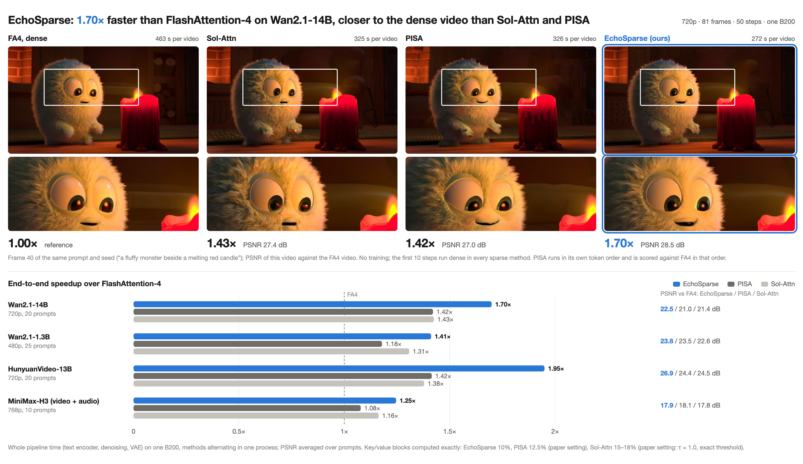
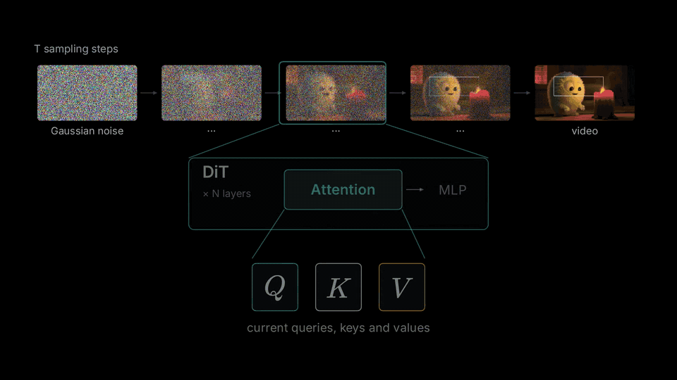
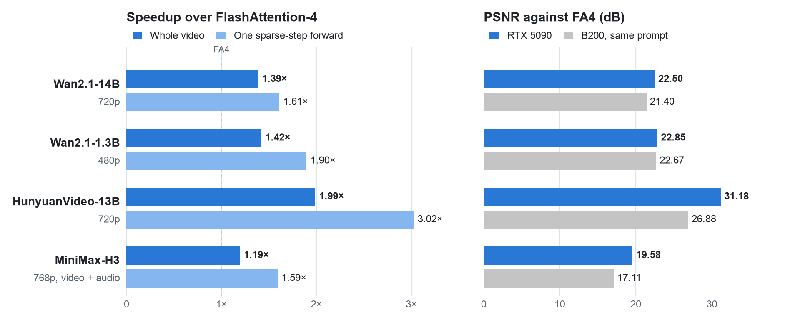
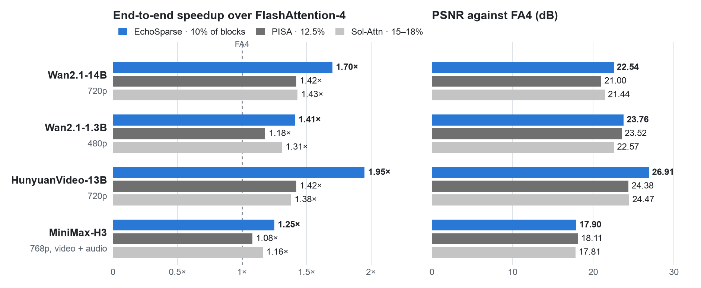

本仓库包含 EchoSparse、VSA 和 VSA2，以及实验性的 H100 split-KV 负载均衡实现。

[调度用法与实测结果](docs/vsa2_splitkv.md) · [交互动画](docs/animations/vsa2-load-balance-standalone.html) · [Canvas](docs/animations/vsa2-load-balance.canvas.tsx)

本分支同时发布实验性的 VSA2 **64/4/1 代表块**包。其 H100 ThunderKittens 后端对 tier A 和连续的 tier C 表使用
tensor TMA，对预 swizzle 的 tier B 表使用一维 `cp.async.bulk`。实现边界、复现命令、实测和未验证项见
[实现与交接文档](docs/vsa2_representative_handoff.md)；这条路径与下文 EchoSparse 的 Triton 实现相互独立。

<div align="center">

<h1>EchoSparse</h1>

<p><b>面向视频扩散 Transformer 的块稀疏注意力，由上一步的 LSE 引导</b></p>

<p>
<a href="https://w2genai-lab.github.io/blog/EchoSparse/zh.html"></a>
<a href="https://w2genai-lab.github.io/blog/EchoSparse/blog.html"></a>
</p>

<p><b><a href="https://w2genai-lab.github.io/blog/EchoSparse/zh.html">中文博客</a></b> &nbsp;·&nbsp; <b><a href="https://w2genai-lab.github.io/blog/EchoSparse/blog.html">English Blog</a></b> &nbsp;·&nbsp; <a href="README.md">English</a> &nbsp;·&nbsp; <a href="#结果">结果</a> &nbsp;·&nbsp; <a href="#安装">安装</a> &nbsp;·&nbsp; <a href="#用法">用法</a></p>



</div>

EchoSparse 是面向视频扩散模型的块稀疏自注意力。每个去噪步的 softmax 统计量会在下一步被再次利用（名字里的
Echo 即指这一点）：用来设定下一步的 softmax 偏移量、选择要计算的块，并决定跳过的块如何补偿。不需要训练，可以
直接接入 diffusers 流水线。可在 NVIDIA B200（SM100）、RTX 5090（SM120）和 H100（SM90）GPU 上运行。

## 动态

- **2026-11-05** — `echosparse.vsa` 提供原生 CUDA [VSA 与 VSA2](#原生-vsa-与-vsa2)：在 H100（SM90）和 RTX 5090（SM120）上
  支持前向与反向。
- **2026-11-04** — EchoSparse 支持 H100（SM90）：[结果](#h100) · [用法](#在-h100-上)。
- **2026-11-01** — EchoSparse 技术博客已发布：[中文](https://w2genai-lab.github.io/blog/EchoSparse/zh.html) · [English](https://w2genai-lab.github.io/blog/EchoSparse/blog.html)。

## 原理

<p align="center">
  
  <br>
  <em>用一个玩具例子演示一层注意力：沿用上一步的 LSE、选块、按聚类得到的代表、统一的归一化、B200 上的融合 kernel，以及 B200 的实测结果。</em>
</p>

相邻两个去噪步之间，每一行注意力的 log-sum-exp（LSE，softmax 分母的对数）变化很小。EchoSparse 为每一层、每个
CFG 分支保存上一步的 LSE，在同一个注意力 kernel 里用到三处：

1. **固定的 softmax 偏移量。** 用上一步的 LSE 代替逐行的运行最大值，kernel 不再求最大值，也不再重新缩放。行和超出
   安全范围的 tile（约 0.5%）改用在线 softmax 重算。在相同的块列表下，kernel 耗时减少约 47%。
2. **同一遍计算顺带得到块概率。** 有了这个偏移量，kernel 算出的指数值已经接近概率，计算选中块时顺带按 64 token
   的块累加，就得到块概率图。下一步直接按这张图给每个 128 行的 query tile 选块，不需要单独的打分计算。
3. **落选块的补偿。** 落选的块仍然进入同一个 softmax：每个块用它的平均 key 和平均 value 代表，权重是块内 token 数；
   块概率最高的三分之一落选块各用 4 个代表，由按 query 度量的 k-means 聚类得到。

前 10 个去噪步用 FlashAttention-4 稠密计算。其中最后一步让所有块都经过本 kernel，生成第一张块概率图。

在 B200 上，kernel 用 CuTe DSL 编写，使用 tcgen05 MMA 和 tensor memory。RTX 5090 和 H100 没有这两者，所以它们的 kernel
用 Triton 编写，使用普通的访存和 tensor core 点积。它们计算的量和精度相同。为了放进 32 GB 显存，RTX 5090 在去噪步之间每层只保留
各 CFG 分支的 LSE 和下一步的选块（存成位图），块概率图是各层共用的临时空间；H100 保留相同的状态。

Triton kernel 从每个 query tile 的两个短列表读取补偿列：用平均值代表的块和细化的块，在展开选块时写出。与逐块掩码相比，
列和权重都相同，只是省去了被掩掉的计算，求和顺序不同。RTX 5090 kernel 把每个 64-token 块分成两个 32-key 的半块计算，
每次 32 个补偿列；H100 kernel 用 8 个 warp 整块计算 64-token 块，每次 128 个补偿列，并在稀疏步把精确块循环做三级软件流水，
让 K / V 的读取与点积重叠；这个 Triton 实现使用普通的指针访存。上面链接的独立 VSA2 代表块 kernel 在 H100 上使用
tensor TMA 和异步 bulk copy。

## 结果

### RTX 5090

<picture>
  <source media="(prefers-color-scheme: dark)" srcset="assets/results-rtx5090-dark.png">
  
</picture>

用本包和 `examples/` 里的脚本做完整的 50 步生成，每个模型 1 个提示词，种子与 B200 评测相同；EchoSparse 和 FA4 稠密
各在一张 GPU 上跑一遍。Wan2.1-14B、HunyuanVideo、MiniMax-H3 的权重放在 CPU 内存里，按组拷到 GPU（`--offload`）；
Wan2.1-1.3B 直接放在 GPU 上。单次前向取同一次运行中稀疏步（EchoSparse）和稠密步（FA4）各自的中位数。MiniMax-H3 用
密度 0.24（`minimax_h3_rtx5090`）。RTX 5090 上没有测 Sol-Attn 和 PISA。

### H100

单张 H100 80 GB 上的首轮 Wan2.1-1.3B 端到端结果：50 步、81 帧、480×832、seed 0，全部权重常驻 GPU。
每条路径用相同输入各运行一次；EchoSparse 密度为 0.10，前 10 步保持稠密。

| 方法 | 完整生成 / 秒 | 对 FA4 的 PSNR / dB |
| --- | ---: | ---: |
| 稠密 FlashAttention-4 | 62.656 | — |
| 旧 H100 EchoSparse（`sm90_wide`） | 49.492 | 24.835 |
| Grouped128＋exact 三级流水线 | 47.487 | 24.831 |

grouped 路径相对 FA4 加速 1.319 倍，比旧 H100 路径减少 4.05% 的完整生成时间。计时包含完整 pipeline 和解码，
排除模型加载、预热、保存及评分；PSNR 使用原生 float32 帧。

### B200

<picture>
  <source media="(prefers-color-scheme: dark)" srcset="assets/results-b200-dark.png">
  
</picture>

完整视频生成使用 50 个去噪步，各方法的前 10 步均采用稠密注意力。EchoSparse 精确计算 10% 的 KV 块；Sol-Attn 使用论文中
的完整阈值估计，τ = 1.0，实际计算 15–18% 的块；PISA 按协方差选择 12.5% 的块。PSNR 以 FA4 为参考，每个模型取 10–25 个
提示词的平均。

EchoSparse 在四个模型上均取得最高加速比。相对 Sol-Attn，PSNR 在 Wan2.1-14B 上高 1.10 dB，
在 Wan2.1-1.3B 上高 1.19 dB，在 HunyuanVideo 上高 2.44 dB。MiniMax-H3 相对 Sol-Attn 和 PISA 的差异分别为
+0.09 dB 和 −0.21 dB；音频 SNR 分别为 EchoSparse 4.9 dB、Sol-Attn 5.4 dB。

Sol-Engine 的对角阈值估计会计算 21–25% 的 KV 块。按上图的模型顺序，Sol-Attn 的 PSNR 为 22.34、23.39、25.47、
18.70 dB，相对 FA4 的加速比分别为 1.24×、1.17×、1.27×、1.10×。EchoSparse 在 Wan 上画质相当，在 HunyuanVideo 上
高 1.44 dB，在 H3 上低 0.8 dB，速度快 1.12–1.54 倍。

## TODO 列表

- [x] 将 EchoSparse 适配到 NVIDIA H100（SM90）。
- [x] 给出 Wan2.1-1.3B 在 H100 上的首轮端到端结果。
- [x] 原生 CUDA VSA 与 VSA2：在 H100（SM90）和 RTX 5090（SM120）上支持前向与反向。
- [x] 增加实验性的 H100 VSA2 64/4/1 代表块 ThunderKittens/TMA 前后向路径。
- [ ] 将 EchoSparse 适配到 NVIDIA RTX 4090（SM89）。
- [ ] 用 TMA 实现生产者-消费者结构，进一步减少访存停顿。

## 安装

需要 B200（SM100）、RTX 5090（SM120）或 H100（SM90）GPU、CUDA 12.8 或更新版本、Python 3.10 或更新版本。

```bash
git clone git@github.com:shaoshitong/self_trainable_or_free_attn.git
cd self_trainable_or_free_attn
pip install torch==2.11.0 --index-url https://download.pytorch.org/whl/cu128
pip install -e ".[examples]"
```

依赖版本固定在 `pyproject.toml` 中。RTX 5090 上，EchoSparse 为 FlashAttention-4 应用
[flash-attention PR #2484](https://github.com/Dao-AILab/flash-attention/pull/2484) 的 SM120 兼容修复。
MiniMax-H3 使用 diffusers 提交 `abc5e9bf` 和 transformers 5.8.1。

MiniMax-H3 的 diffusers 源码放在本仓库旁边，通过源码路径加载：

```bash
git clone https://github.com/huggingface/diffusers.git ../diffusers-h3
git -C ../diffusers-h3 checkout abc5e9bf71fd38f53cd471bc3acaa84bc5ecbfdc
pip install transformers==5.8.1
export PYTHONPATH="$(pwd)/../diffusers-h3/src:${PYTHONPATH}"
```

## 用法

### 快速开始

在 B200 上，所有权重都放在 GPU 上：

```python
import torch
from diffusers import AutoencoderKLWan, UniPCMultistepScheduler, WanPipeline
import echosparse

model = "Wan-AI/Wan2.1-T2V-14B-Diffusers"
vae = AutoencoderKLWan.from_pretrained(model, subfolder="vae", torch_dtype=torch.float32)
pipe = WanPipeline.from_pretrained(model, vae=vae, torch_dtype=torch.bfloat16)
pipe.scheduler = UniPCMultistepScheduler.from_config(pipe.scheduler.config, flow_shift=5.0)
pipe.to("cuda")

echosparse.enable(pipe)      # 在设置好调度器之后调用：注意力按调度器的步数推进
video = pipe(prompt="A cat surfing at sunset", height=720, width=1280, num_frames=81,
             guidance_scale=5.0, num_inference_steps=50).frames[0]
```

`enable` 会识别模型并使用对应的预设。关键字参数可以覆盖预设中的 `density`、`dense_steps`、`dense_layers` 和
`refine_iters`。三个模型的完整脚本在 `examples/` 目录，支持通过 CPU 权重卸载在 32 GB RTX 5090 上运行。

### 在 RTX 5090 上

480p 的 Wan2.1-1.3B 可以直接放进 32 GB 显存：

```bash
python examples/wan.py --model Wan-AI/Wan2.1-T2V-1.3B-Diffusers --prompt "A cat surfing at sunset"
```

较大的模型通过 `--offload` 把权重保存在 CPU 上，每组执行时再拷入 GPU：

```bash
python examples/wan.py --prompt "A cat surfing at sunset" --offload
python examples/hunyuan_video.py --prompt "A cat surfing at sunset" --offload
python examples/minimax_h3.py --model /path/to/MiniMax-H3 --prompt "A cat surfing at sunset" \
    --preset minimax_h3_rtx5090 --offload
```

Wan 的权重卸载每组包含 1 个 block，HunyuanVideo 为 16 个，H3 默认为 8 个；H3 用 `--group-size 12 --pin` 的单次
前向耗时相同。`examples/minimax_h3.py` 会设置 `PYTORCH_CUDA_ALLOC_CONF=expandable_segments:True`，减少 32 GB GPU 上
CUDA 显存的碎片。

上述分辨率下，去噪步之间保留的注意力状态：Wan2.1-14B 两个 CFG 分支共约 1.89 GB，HunyuanVideo 约 1.37 GB，
MiniMax-H3 约 0.63 GB，另需一份共享工作缓冲区。这些状态在推理期间始终保存在 GPU 上。

### 在 H100 上

Wan2.1-1.3B 在 480×832 下（即 [H100 结果](#h100) 的设置）可将全部权重放在 80 GB GPU 上运行：

```bash
python examples/wan.py --model Wan-AI/Wan2.1-T2V-1.3B-Diffusers --prompt "A cat surfing at sunset"
```

在 Python 中，按快速开始的写法换成 `examples/wan.py` 的 1.3B 设置：

```python
model = "Wan-AI/Wan2.1-T2V-1.3B-Diffusers"
vae = AutoencoderKLWan.from_pretrained(model, subfolder="vae", torch_dtype=torch.float32)
pipe = WanPipeline.from_pretrained(model, vae=vae, torch_dtype=torch.bfloat16)
pipe.scheduler = UniPCMultistepScheduler.from_config(pipe.scheduler.config, flow_shift=3.0)
pipe.to("cuda")

echosparse.enable(pipe, gpu="h100")
video = pipe(prompt="A cat surfing at sunset", height=480, width=832, num_frames=81,
             guidance_scale=6.0, num_inference_steps=50).frames[0]
```

若要指定 GPU 类型，传入 `gpu="b200"`、`gpu="rtx5090"` 或 `gpu="h100"`；在不符的 GPU 上调用时会报错。

### 预设

| 模型 | 密度 | 稠密步数 | 稠密层 | 说明 |
|---|---|---|---|---|
| Wan2.1 | 0.10 | 10 | 0 | 视频 token 按三维 Morton 顺序重排 |
| HunyuanVideo | 0.10 | 10 | 无 | 文本 token 对每个 tile 都精确计算；文本 query 行用 FA4 |
| MiniMax-H3 | 0.10 | 10 | 0 | 打包序列的前缀对每个 tile 都精确计算；前缀 query 行用 FA4 |

预设 `minimax_h3_rtx5090` 使用密度 0.24，即上述 RTX 5090 测量采用的设置：

```python
echosparse.enable(pipe, preset="minimax_h3_rtx5090")      # 密度 0.24，10 个稠密步，第 0 层稠密
```

### 其他模型

可以直接调用 `echosparse.EchoSparseAttention`：

```python
attn = echosparse.EchoSparseAttention(density=0.10, dense_steps=10, dense_layers=(0,))
attn.reset()                                           # 每段视频开始前调用
out = attn(q, k, v, step=step, branch=branch, layer=layer)
```

`q`、`k`、`v` 是一次自注意力调用的 `[1, L, heads, 128]` bf16 张量（批大小为 1，query 与 key 长度相同；短于 4096
token 的序列走稠密计算）。`branch` 是一个去噪步内 transformer 前向的序号（条件分支为 0，无条件分支为 1），后面的
分支复用分支 0 的选块结果。需要被所有 query 精确计算的 token（文本、条件输入）放在序列末尾，并把 `sink` 设为它们
所在的第一个 64 token 块的序号。如果调用方自己重算末尾的一些 query 行（MiniMax-H3 的集成对前缀就是这样做的），
`rows=n` 告诉注意力只用到前 `n` 行输出；RTX 5090 和 H100 的 kernel 会跳过之后的 query tile。`enable` 会替换 diffusers 中
该模型的注意力分派函数，所以一个进程里只用一条流水线。

### 原生 VSA 与 VSA2

`echosparse.vsa` 提供两种可训练稀疏注意力的原生 CUDA 前向与反向：原始 [VSA](https://github.com/hao-ai-lab/FastVideo)
（`vsa_attention`：64 token 块均值，每个 query 块取 K 个 kv 块，粗粒度分支乘完整的 `[B, H, L, D]` 权重）和 VSA2
（`vsa2_attention`：16 token 路由池化，每个头精确选 NB·K 个块对，每个 token 一个标量 tanh 门控）。它们是需要自行
调用的无状态函数，`enable` 和 `EchoSparseAttention` 不会使用它们。扩展只在显式要求时编译。

RTX 5090（SM120，CUDA 12.8）：

```bash
ECHOSPARSE_VSA_BUILD=1 TORCH_CUDA_ARCH_LIST=12.0 pip install -e . --no-build-isolation
```

H100（SM90），附带 ThunderKittens 细粒度 kernel，版本为 `setup.py` 中固定的提交：

```bash
git clone https://github.com/HazyResearch/ThunderKittens third_party/ThunderKittens
git -C third_party/ThunderKittens checkout 6c27e28c8115d1839d9eeeb530913c184a75fc87
ECHOSPARSE_VSA_BUILD=1 ECHOSPARSE_VSA_TK=1 TORCH_CUDA_ARCH_LIST=9.0a pip install -e . --no-build-isolation
```

两者的输入是按 64 token 块排列的 bf16 或 fp16 `[B, H, NB*64, D]` 张量（D 为 64 或 128），每块前 `blk_cnt` 个是真实
token。布局用 `to_blocked` 把真实 token 映射过去、用 `from_blocked` 映射回来，q、k、v、VSA 权重和 VSA2 门控都一样；
填充位置输出为零，也不接收梯度。`sequence_layout(n, device)` 把一维序列切成连续的块；按光栅顺序排列的视频用
`build_layout((T, H, W), R=16, device=...)`，每块是一个 4×4×4 tile，每个 16 token 路由组是其中的子立方体。

```python
import torch
from echosparse import vsa

B, heads, n, D, dev = 1, 4, 4096, 64, "cuda"
q, k, v = (torch.randn(B, heads, n, D, device=dev, dtype=torch.bfloat16, requires_grad=True) for _ in range(3))
w = torch.rand(B, heads, n, D, device=dev, dtype=torch.bfloat16, requires_grad=True)     # VSA: full coarse weight
gate = torch.randn(B, heads, n, device=dev, dtype=torch.bfloat16, requires_grad=True)    # VSA2: scalar gate per token

lay = vsa.sequence_layout(n, dev)             # 视频：vsa.build_layout((T, H, W), R=16, device=dev)
qb, kb, vb, wb, gb = (vsa.to_blocked(x, lay) for x in (q, k, v, w, gate))   # [B, heads, NB*64, ...]
o_vsa = vsa.from_blocked(vsa.vsa_attention(qb, kb, vb, lay.blk_cnt, topk=16, weight=wb), lay)
o_vsa2 = vsa.from_blocked(vsa.vsa2_attention(qb, kb, vb, gb, lay.blk_cnt, R=16, topk=16), lay)
loss = o_vsa.float().square().mean() + o_vsa2.float().square().mean()
loss.backward()                                                      # 一次反向经过共享的布局转换
```

`python -m pytest tests/test_vsa.py tests/test_vsa2.py` 用 PyTorch 参考实现检查两者。

面向 H100 上偏斜选择的实验性 split-KV 调度（`split_kv=vsa.SplitKV(...)`，默认关闭）及其测量结果（包括变慢的情形）见
[docs/vsa2_splitkv.md](docs/vsa2_splitkv.md)。

## 许可证

Apache License 2.0。第三方来源见 [NOTICE](NOTICE)。

## 核心贡献者

Shitong Shao<sup>\*</sup>、Tian Ye<sup>\*</sup>

<sup>\*</sup> 同等贡献，按姓名首字母排序。

## 其他贡献者

Sixiang Chen、Song Fei、Wenxue Li。
